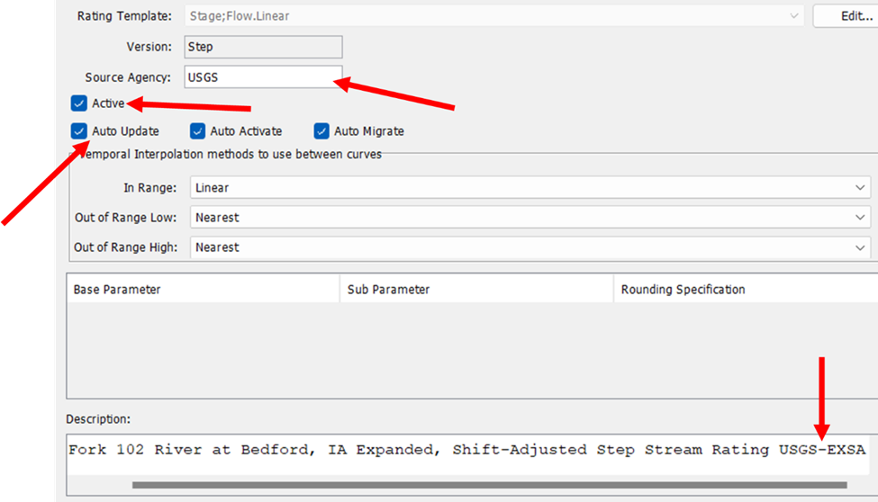
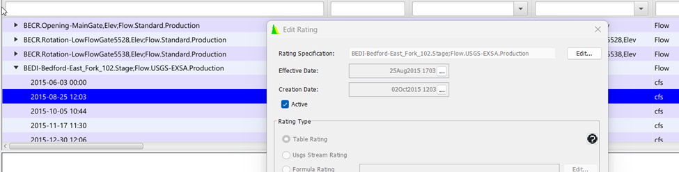
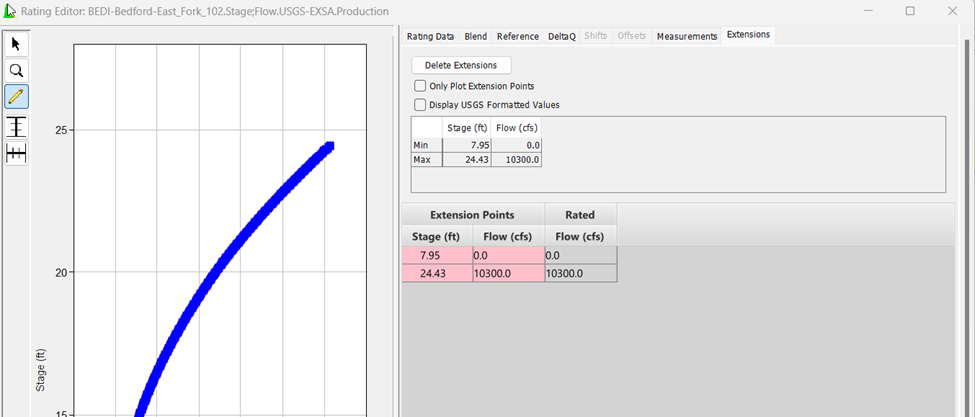
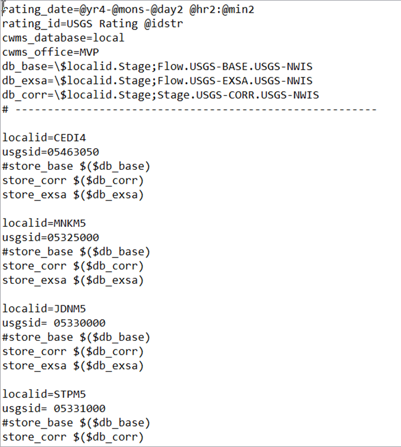

USGS workflows
==============

The ``usgs`` command group retrieves USGS data and stores it in CWMS through
the CWMS Data API (CDA). It includes continuous time-series values, ratings,
measurements, and migration support for installations moving from legacy USGS
method IDs to the USGS Water Data API.

Prerequisites and authentication
---------------------------------

Install the optional dependencies used by USGS commands:

.. code-block:: bash

   pip install cwms-python dataretrieval

USGS commands use the shared CDA options documented in
:doc:`Common API Arguments <api_arguments>`:

* ``--office`` / ``OFFICE``
* ``--api-root`` / ``CDA_API_ROOT``
* ``--api-key`` / ``CDA_API_KEY``
* ``--api-key-loc``

The Water Data API key is optional. Provide it with ``--usgs-api-key`` or the
``USGS_API_KEY`` environment variable. When neither is provided,
``dataretrieval`` can use its configured ``API_USGS_PAT`` environment value.
The CLI warns when no USGS key is supplied.

Configure CWMS group assignments
--------------------------------

Before retrieving values, configure these groups in CWMS for the target
office:

1. In **Agency Aliases / USGS Station Number**, assign the USGS site number to
   the CWMS location. Enter the station number, such as ``05389500``, as the
   location's ``alias-id``; do not include the ``USGS-`` prefix. The CLI uses
   this alias to form the USGS monitoring location ID. If a time series uses a
   sublocation without its own station alias, the CLI can use the alias on its
   base location.
2. In **Data Acquisition / USGS TS Data Acquisition**, assign the CWMS time
   series that should be populated by USGS data.
3. Set the group's ``attribute`` to a USGS parameter code when the default
   mapping for the CWMS parameter is not the one you need. The current default
   mappings include:

   +----------------+------------------+
   | CWMS parameter | USGS code        |
   +================+==================+
   | Temp-Water     | 00010            |
   +----------------+------------------+
   | Temp-Air       | 00021            |
   +----------------+------------------+
   | Speed-Wind     | 00035            |
   +----------------+------------------+
   | Dir-Wind       | 00036            |
   +----------------+------------------+
   | Precip-Inc     | 00045            |
   +----------------+------------------+
   | Precip         | 00045            |
   +----------------+------------------+
   | %-Humidity     | 00052            |
   +----------------+------------------+
   | Flow           | 00060            |
   +----------------+------------------+
   | Stage          | 00065            |
   +----------------+------------------+
   | Cond           | 00095            |
   +----------------+------------------+
   | Conc-Salinity  | 00096            |
   +----------------+------------------+
   | Stor           | 72036            |
   +----------------+------------------+
   | Irrad-Solar    | 62608            |
   +----------------+------------------+
   | Elev           | 63160            |
   +----------------+------------------+

   Leave the attribute blank or set it to ``0`` to use the default mapping.
   Enter the five-digit USGS code to override it.
4. If the station and parameter identify more than one USGS time series, set
   the time-series group's ``alias-id`` to the specific USGS ``id`` found in
   :ref:`Finding a USGS time_series_id <finding-usgs-timeseries-id>`. Leave
   it blank when a station-and-parameter query identifies the desired series
   without ambiguity. Do not enter a legacy numeric method ID; use
   :ref:`the migration workflow <migrate-usgs-timeseries-ids>` for those
   configurations.

Save the group changes in CWMS before running ``cwms-cli usgs timeseries``.

Continuous values
-----------------

Retrieve USGS continuous values with:

.. code-block:: bash

   cwms-cli usgs timeseries \
     --office SWT \
     --api-root https://cwms-data.usace.army.mil/cwms-data \
     --api-key "$CDA_API_KEY" \
     --days-back 1 \
     --usgs-api-key "$USGS_API_KEY"

The ``USGS TS Data Acquisition`` group controls how each CWMS time series is
queried:

* A blank ``alias-id`` queries by USGS station number and parameter code.
* A non-numeric USGS ``time_series_id`` in ``alias-id`` queries that series
  directly.
* Numeric legacy method IDs are not interpreted as new IDs. They are skipped
  and must be migrated first; see :ref:`migrate-usgs-timeseries-ids`.

``--days-back`` selects observations modified during the lookback window. By
default, observations are also limited to that same period. Use
``--revision-lookback-days`` to retrieve older observations that were revised
within the day back window.  For exmaple, ``--days-back 1 --revision-lookback-days 7`` 
retrieves observations modified in the last day, including any revisions to observations 
from the last week.  By default -revision-lookback-days is set to --day-back mimicking 
the behavior of previous versions.  

Use ``--backfill`` with a comma-separated list of CWMS time-series IDs to
process only selected series. Use ``--backfill-version`` to write to another
existing version, such as ``Rev-USGS`` instead of ``Raw-USGS``. The command
checks that the requested version exists and skips source series without a
matching destination.

Finding a USGS ``time_series_id``
---------------------------------

.. _finding-usgs-timeseries-id:

You can find the identifier in the USGS Water Data website without making an
API request manually:

1. Open the USGS `Download data form
   <https://api.waterdata.usgs.gov/download>`_.
2. Enter the monitoring location ID. The form accepts IDs such as
   ``USGS-05389500``. You can also select a state or county.
3. Enter the five-digit parameter code, such as ``00065`` for gage height.
4. Select **Time series metadata**, then click **Download data**.

Open the downloaded CSV to see the time series available for that site and
parameter. Use the ``web_description`` field to help identify the correct time
series for your CWMS record. The value to enter in the CWMS ``USGS TS Data
Acquisition`` group's ``alias-id`` field is the ``id`` value in the first
column of the CSV.

For example, enter ``USGS-05389500`` as the monitoring location ID, select the
desired parameter, and inspect the downloaded metadata rows. Choose the row
whose ``web_description`` matches the time series you need, then copy its
first-column ``id`` into ``alias-id``. After updating the alias, use
``cwms-cli usgs timeseries`` to retrieve data for the configured CWMS time
series.

Ratings
-------

Rating specification setup
^^^^^^^^^^^^^^^^^^^^^^^^^^

The ratings command uses CWMS rating specifications for the requested office.
Each specification's location must have a USGS station number in the
**Agency Aliases / USGS Station Number** group described above. Configure the
rating specification in CWMS-Vue with:

* **Source Agency** set to ``USGS``.
* **Active** and **Auto Update** enabled.
* A description containing one rating type marker:
  ``USGS-EXSA`` (extrapolated), ``USGS-CORR`` (corrected), or ``USGS-BASE``
  (base). The marker determines which USGS rating the command retrieves.

The current command selects specifications that are active, have Auto Update
enabled, and contain one of these markers in the description. The following
CWMS-Vue screenshot illustrates the rating specification settings. Image
from the HEC USGS ratings guide.

The **Auto Activate** flag controls whether a newly stored rating is active.
Disable it if new USGS ratings should be stored inactive. Image from the
HEC USGS ratings guide.

When **Auto Migrate** is enabled, extensions on the existing rating
are migrated to the newly stored rating. This option applies when a rating
already exists. Image from the HEC USGS ratings guide.

Run the ratings command
^^^^^^^^^^^^^^^^^^^^^^^

Retrieve updated USGS ratings with:

.. code-block:: bash

   cwms-cli usgs ratings \
     --office SWT \
     --api-root https://cwms-data.usace.army.mil/cwms-data \
     --api-key "$CDA_API_KEY" \
     --days-back 1 \
     --usgs-api-key "$USGS_API_KEY"

By default, existing rating specifications are selected when their USGS
rating asset was updated during ``--days-back``. New specifications without an
existing CWMS curve are included when their asset is updated. Use
``--rating-subset`` with comma-separated rating specification IDs to retrieve
the current rating for selected specifications regardless of the update
window. A rating is not stored again when its USGS effective date already
matches the most recent effective date in CWMS.

``--days-back`` is the USGS rating-asset update lookback. For example,
``--days-back 2`` checks rating assets updated in the last two days; it does
not mean that rating curves older than two days are discarded.

Use ``--dry-run`` to retrieve and validate ratings without writing them to
CWMS:

.. code-block:: bash

   cwms-cli usgs ratings --office SWT --rating-subset "rating-id-1" --dry-run

Measurements and rating imports
-------------------------------

The measurements and rating-spec import commands are also available:

.. code-block:: bash

   cwms-cli usgs measurements --office SWT
   cwms-cli usgs ratings-ini-file-import --filename ratings.ini

The ``ratings-ini-file-import`` command updates rating specifications listed
in a legacy ratings INI file. For recognized ``store_exsa``, ``store_corr``,
``store_base``, or ``replace_exsa`` entries, it sets Source Agency to ``USGS``,
enables Active, Auto Update, and Auto Activate, and adds the matching
``USGS-EXSA``, ``USGS-CORR``, or ``USGS-BASE`` description marker. Use
``--dry-run`` to preview the proposed changes before applying them.

The image below shows an example of the INI file format from the HEC USGS
ratings guide.

See ``cwms-cli usgs <command> --help`` for the complete options for each
command.

.. _migrate-usgs-timeseries-ids:

Migrate legacy time-series IDs
------------------------------

Older configurations may store numeric USGS WaterServices ``methodID`` values
in the ``alias-id`` field. The new continuous-value workflow requires USGS
Water Data API ``time_series_id`` values or blank aliases. The migration
command builds a crosswalk and is dry-run by default:

.. code-block:: bash

   cwms-cli usgs migrate-timeseries-ids \
     --office SWT \
     --api-root https://cwms-data.usace.army.mil/cwms-data \
     --api-key "$CDA_API_KEY" \
     --output-dir usgs-migration

The command obtains legacy method descriptions from the old WaterServices API
unless ``--legacy-methods-csv`` is supplied. A CSV supplied with that option
must contain:

.. code-block:: text

   USGS_St_Num,USGS_PARAMETER,methodID,methodDescription

Use ``--timeseries-ids`` to test a comma-separated subset before processing an
entire office. Review the generated reports, especially the crosswalk and
update plan, before applying changes.

Optional value comparison provides an additional safety check:

.. code-block:: bash

   cwms-cli usgs migrate-timeseries-ids \
     --office SWT \
     --api-root https://cwms-data.usace.army.mil/cwms-data \
     --output-dir usgs-migration \
     --compare-timeseries \
     --compare-days 3 \
     --comparison-min-records 20 \
     --comparison-min-agreement 95

Value comparison matches recent CWMS and USGS observations after unit
normalization. A mapping is eligible only when the configured minimum overlap
and agreement thresholds are met. The default comparison settings are three
days, 20 records, 95 percent agreement, and a maximum absolute difference of
``0.001``.

Apply only reviewed mappings with ``--apply``:

.. code-block:: bash

   cwms-cli usgs migrate-timeseries-ids \
     --office SWT \
     --api-root https://cwms-data.usace.army.mil/cwms-data \
     --output-dir usgs-migration \
     --compare-timeseries \
     --apply

Without ``--apply``, the command writes reports but does not change CWMS.
Only unambiguous mappings are included in the update plan. Existing group
attributes are preserved when aliases are updated. The output directory can
contain:

* ``legacy_methods_*.csv`` and ``new_usgs_metadata_*.csv`` input reports
* ``methodid_to_timeseriesid_crosswalk_*.csv`` mapping results
* ``cwms_alias_update_plan_*.csv`` eligible updates
* ``cwms_alias_patch_*.csv`` proposed CWMS group changes
* ``migration_summary_*.csv`` status counts
* comparison and mismatch reports when ``--compare-timeseries`` is enabled

Review statuses such as ``matched``, ``matched_by_value_comparison``,
``matched_without_alias_by_value_comparison``, ambiguous mappings, and
comparison failures before applying updates.

Python support
--------------

This release supports Python 3.10 and newer within the tested range. CI tests
Python 3.10 and 3.13, and the development container tests Python 3.12.
